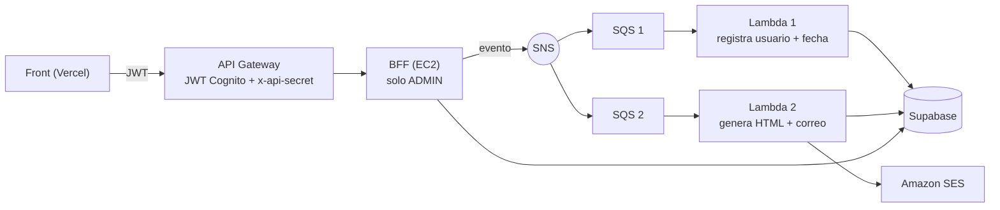

# ms-goldenoddjobs-bff

BFF (Backend For Frontend) de **Golden-Oddjobs**. Recibe la petición de generar un informe, la publica en un broker y responde de inmediato; el trabajo pesado lo hacen dos Lambdas de forma asíncrona.

Proyecto del ramo **Desarrollo Cloud Native I (DSY1107)**, Duoc UC.

## Flujo

1. El **administrador** pulsa "Generar informe" en el front (Vercel).
2. La petición pasa por **API Gateway**, que valida el JWT de Cognito e inyecta el header secreto `x-api-secret`.
3. El **BFF** (EC2) comprueba que el token pertenece al grupo `ADMIN`, guarda el informe como `PENDIENTE`, publica un evento en **SNS** y responde `202 Solicitud recibida con éxito`.
4. SNS entrega el mismo evento a **dos colas SQS**:

| Cola | Lambda | Trabajo |
|---|---|---|
| 1 | `informe-registrar` (`lambdas/lambda-1-registrar-solicitud`) | Guarda en Supabase **quién** pidió el informe y **cuándo** (tabla `registro_informe`) |
| 2 | `informe-generar` (`lambdas/lambda-2-generar-informe`) | Lee Supabase, genera el informe en **HTML**, lo **envía por correo** (SES) y marca el informe `GENERADO` |



## Seguridad

- **API Gateway** valida el JWT de Cognito antes de dejar pasar la petición.
- **El BFF solo acepta tráfico del Gateway**: con `BFF_ENFORCE_SECRET_ON_ALL=true` cualquier `/api/**` (menos `/api/health`) sin el header `x-api-secret` correcto recibe `401`. El Gateway agrega ese header con *parameter mapping* en las integraciones del BFF. La comparación es en tiempo constante.
- **El BFF vuelve a validar el JWT** (firma, issuer, `client_id`, `token_use=access`) y exige el grupo `ADMIN` en `/api/informes` (`403` para cualquier otro rol).
- Credenciales de Supabase y AWS solo por variables de entorno.

## Endpoints

| Método | Ruta | Protección | Respuesta |
|---|---|---|---|
| GET | `/api/health` | Pública | `200` con estado y broker |
| POST | `/api/informes` | JWT + grupo `ADMIN` + `x-api-secret` | `202` "Solicitud recibida con éxito" |
| GET | `/api/informes` | JWT + grupo `ADMIN` + `x-api-secret` | `200` lista de informes |

`/api/notice` y `/api/notificaciones` siguen en el código (fase anterior) pero ya no forman parte del flujo ni se publican en el Gateway.

Cuerpo opcional de `POST /api/informes`: `{ "email": "...", "nombre": "..." }`. El front lo envía desde el ID token porque el access token de Cognito no trae el correo. Si el token trae `email`, tiene prioridad.

## Evento

```json
{
  "eventId": "6f1c...",
  "tipo": "INFORME_SOLICITADO",
  "informeId": 7,
  "solicitanteSub": "<sub de Cognito>",
  "solicitanteNombre": "Ana Admin",
  "email": "ana@correo.cl",
  "tipoInforme": "RESUMEN_GENERAL",
  "solicitadoEn": "2026-10-14T13:00:00Z"
}
```

Ambas Lambdas son idempotentes por `eventId` y usan `ReportBatchItemFailures`: si SQS entrega un mensaje dos veces no se duplica la fila ni el correo, y si algo falla solo se reintenta ese mensaje.

## Broker intercambiable

El código solo conoce la interfaz `InformePublisher`. `MESSAGING_PROVIDER=sns` (por defecto) publica en SNS. `MESSAGING_PROVIDER=rabbit` publica en un exchange RabbitMQ y los listeners del propio BFF hacen el trabajo; ese modo conserva el comportamiento de la fase anterior y **no envía correo**.

## Variables de entorno

Ver `.env.example`. Las credenciales del Learner Lab (`AWS_ACCESS_KEY_ID`, `AWS_SECRET_ACCESS_KEY`, `AWS_SESSION_TOKEN`) cambian en cada sesión.

## Correr y probar

```bash
cp .env.example .env
mvn test                          # pruebas Java
node lambdas/_test/run.mjs        # pruebas de las Lambdas, sin AWS
mvn spring-boot:run               # con las variables exportadas
```

En la EC2 se levanta junto a los otros servicios con `ms-goldenoddjobs-usuarios/infra/docker-compose.yml`.

## Montaje en AWS (Learner Lab)

### 1. Supabase
Ejecuta `db/schema.sql` en **SQL Editor** (crea `informe`, `registro_informe` y `notificacion`). Anota la Project URL y la **service_role key**.

### 2. SNS + 2 colas SQS
1. Topic *Standard* `informe-topic`. Su ARN va en `SNS_TOPIC_ARN`.
2. Colas *Standard* `informe-cola-1` e `informe-cola-2` (visibility timeout 60 s).
3. En **cada cola** → *SNS subscriptions* → suscribirla a `informe-topic`.

### 3. Amazon SES
En **SES → Verified identities** verifica el correo remitente (`MAIL_FROM`) y, mientras la cuenta esté en *sandbox*, también el correo del destinatario. Cada correo recibe un mensaje de verificación que hay que aceptar.

### 4. Lambdas (en el Lab se crean desde blueprint "Process messages in Amazon SQS", Node.js 20.x, rol **LabRole**)

| Función | Cola (trigger) | Código | Variables |
|---|---|---|---|
| `informe-registrar` | `informe-cola-1` | `lambdas/lambda-1-registrar-solicitud/index.mjs` | `SUPABASE_URL`, `SUPABASE_SERVICE_KEY` |
| `informe-generar` | `informe-cola-2` | `lambdas/lambda-2-generar-informe/index.mjs` | `SUPABASE_URL`, `SUPABASE_SERVICE_KEY`, `MAIL_FROM`, `MAIL_TO` (opcional) |

Pega el código en `index.mjs` → **Deploy**. Timeout 30 s. En cada trigger activa **Report batch item failures**.

### 5. API Gateway

| Ruta | Integración | Authorizer JWT | Parameter mapping |
|---|---|---|---|
| `GET /api/health` | `http://<IP_EC2>:8083/api/health` | No | |
| `POST /api/informes` | `http://<IP_EC2>:8083/api/informes` | Sí | Overwrite header `x-api-secret` |
| `GET /api/informes` | `http://<IP_EC2>:8083/api/informes` | Sí | Overwrite header `x-api-secret` |

CORS: orígenes `http://localhost:5173` + dominio de Vercel; métodos `GET, POST, OPTIONS`; headers `authorization, content-type`. Abre el puerto **8083** en el Security Group.

### 6. Verificar

```bash
API=https://<api-id>.execute-api.us-east-1.amazonaws.com
curl -i $API/api/health                                          # 200
curl -i -X POST $API/api/informes                                # 401 sin token
curl -i -X POST $API/api/informes -H "Authorization: Bearer $TOKEN_NO_ADMIN"  # 403
curl -i -X POST $API/api/informes -H "Authorization: Bearer $TOKEN_ADMIN" -H "Content-Type: application/json" -d '{}'  # 202
```

Evidencia: logs de ambas Lambdas en CloudWatch, mensajes en las colas, fila en `registro_informe`, informe en `GENERADO` y el correo recibido.

## Estructura

```
src/main/java/cl/goldenoddjobs/bff/
├── config/        SecurityConfig, ApiSecretFilter
├── controller/    Health, Informe, Notice, Notificacion, ApiExceptionHandler
├── dto/           InformeEvent, InformeRequest, NoticeRequest
├── messaging/     InformePublisher (puerto) + Sns/Rabbit (adaptadores)
├── model/         Informe, Notificacion, EstadoInforme
├── repository/
└── service/       InformeService, NoticeService, InformeGenerador
lambdas/           lambda-1-registrar-solicitud, lambda-2-generar-informe, _test, _obsoleto
db/schema.sql
```
