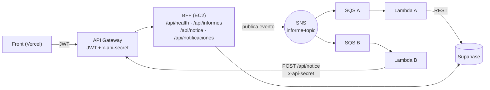

# ms-goldenoddjobs-bff

BFF (Backend For Frontend) de **Golden-Oddjobs**. Es la puerta de entrada del flujo **asíncrono de informes y notificaciones**: recibe la petición del front, la encola en un broker y responde de inmediato, sin esperar a que el trabajo termine.

Proyecto del ramo **Desarrollo Cloud Native I (DSY1107)** — Duoc UC.

## Qué hace

1. El usuario hace clic en **"Generar informe"** (front en Vercel).
2. La petición pasa por **API Gateway** (valida el JWT de Cognito) y llega a este BFF en la EC2.
3. El BFF guarda el informe como `PENDIENTE`, **publica un evento** en el broker y responde `202 — Solicitud recibida con éxito`.
4. El broker entrega el mismo evento a **dos colas**; cada una tiene su consumidor:

| Cola | Consumidor | Trabajo |
|---|---|---|
| A | Lambda A (`lambda-a-generar-informe`) | Genera el informe y lo marca `GENERADO` en Supabase |
| B | Lambda B (`lambda-b-notificar`) | Hace `POST /api/notice` a esta misma app para crear la notificación |

5. El front consulta `GET /api/informes` y `GET /api/notificaciones` y muestra el resultado.



## Broker "plug and play"

El código solo conoce la interfaz `InformePublisher`. Cambiar de broker es cambiar **una variable**:

| `MESSAGING_PROVIDER` | Publica en | Quién consume |
|---|---|---|
| `sns` (por defecto) | Topic SNS → fanout a 2 colas SQS | 2 Lambdas |
| `rabbit` | Exchange fanout `informe` (RabbitMQ / Amazon MQ) → colas `informe` y `db-informe` | 2 `@RabbitListener` dentro del BFF |

La lógica (generar informe, registrar notificación) vive en `InformeService` y `NoticeService`; los listeners y las Lambdas solo la invocan. Ambos modos usan el **mismo evento JSON** (`InformeEvent`) y ambos son **idempotentes** por `eventId` (si el broker entrega un mensaje dos veces, no se duplica nada).

## Endpoints

| Método | Ruta | Protección | Respuesta |
|---|---|---|---|
| GET | `/api/health` | Pública | `200` con estado y broker activo |
| POST | `/api/informes` | JWT (cualquier rol) | `202` "Solicitud recibida con éxito" |
| GET | `/api/informes` | JWT (ADMIN ve todos, el resto los suyos) | `200` lista |
| POST | `/api/notice` | Header `x-api-secret` (sin JWT) | `201` creada · `200` duplicado · `401` secreto inválido |
| GET | `/api/notificaciones` | JWT | `200` notificaciones del usuario |

## Evento

```json
{
  "eventId": "6f1c...",
  "tipo": "INFORME_SOLICITADO",
  "informeId": 7,
  "solicitanteSub": "<sub de Cognito>",
  "email": "usuario@correo.cl",
  "tipoInforme": "RESUMEN_GENERAL",
  "solicitadoEn": "2026-10-14T13:00:00Z"
}
```

## Seguridad

- JWT de Cognito validado igual que en los otros microservicios (firma, issuer, `client_id` + `token_use=access`).
- `/api/notice` no tiene usuario: lo protege el header `x-api-secret` (comparación en tiempo constante). Lo llama la Lambda B.
- `BFF_ENFORCE_SECRET_ON_ALL=true` hace que **todo** `/api/**` (menos `/health`) exija el secreto, para que la EC2 solo acepte tráfico que pasó por API Gateway.
- **Importante:** API Gateway debe inyectar `x-api-secret` en las integraciones protegidas por JWT, pero **nunca** en la de `/api/notice` (la ruta es pública: si el Gateway pusiera el secreto, cualquiera lo obtendría). En `/api/notice` el secreto lo envía la Lambda B.

## Variables de entorno

Ver `.env.example`. Las del Learner Lab (`AWS_ACCESS_KEY_ID`, `AWS_SECRET_ACCESS_KEY`, `AWS_SESSION_TOKEN`) cambian en cada sesión.

## Correr en local

```bash
cp .env.example .env        # completa los valores
mvn spring-boot:run          # requiere las variables exportadas
curl http://localhost:8083/api/health
```

Con Docker (en la EC2 se levanta junto a los otros servicios, ver `ms-goldenoddjobs-usuarios/infra/docker-compose.yml`):

```bash
docker build -t bff . && docker run --env-file .env -p 8083:8083 bff
```

Pruebas unitarias: `mvn test`. Pruebas de las Lambdas sin AWS: `node lambdas/_test/run.mjs`.

## Montaje en AWS (Learner Lab)

### 1. Supabase
Ejecuta `db/schema.sql` en **SQL Editor**. Anota la *Project URL* (`https://<ref>.supabase.co`) y la **service_role key** (Settings → API) para la Lambda A.

### 2. SNS + 2 colas SQS
1. **SNS → Topics → Create topic** → tipo *Standard*, nombre `informe-topic`. Copia el ARN a `SNS_TOPIC_ARN`.
2. **SQS → Create queue** (Standard) dos veces: `informe-cola-a` e `informe-cola-b`. *Visibility timeout* = 60 s.
3. En **cada cola** → pestaña *SNS subscriptions* → **Subscribe to Amazon SNS topic** → elige `informe-topic`. (Hacerlo desde SQS agrega solo la política que permite a SNS escribir en la cola.)
4. Opcional: en cada suscripción activa *Raw message delivery*. Las Lambdas funcionan con y sin ella.

### 3. Lambdas (en el Lab solo se crean desde blueprint)
Para cada una: **Lambda → Create function → Use a blueprint → "Process messages in Amazon SQS"**, runtime Node.js 20.x, rol existente **LabRole**.

| Función | Cola (trigger) | Código | Variables de entorno |
|---|---|---|---|
| `informe-generar` | `informe-cola-a` | `lambdas/lambda-a-generar-informe/index.mjs` | `SUPABASE_URL`, `SUPABASE_SERVICE_KEY` |
| `informe-notificar` | `informe-cola-b` | `lambdas/lambda-b-notificar/index.mjs` | `NOTICE_URL`, `API_SECRET` |

Después de crearlas: pega el código en `index.mjs` (handler `index.handler`) → **Deploy**. En el trigger SQS activa **Report batch item failures** y fija *Batch size* en 1–5. `NOTICE_URL` es la URL pública de API Gateway terminada en `/api/notice`.

### 4. API Gateway
Agrega las rutas al API existente (cada una con **su propia integración** al path completo, como en los otros servicios):

| Ruta | Integración | Authorizer JWT | Parameter mapping |
|---|---|---|---|
| `GET /api/health` | `http://<IP_EC2>:8083/api/health` | No | — |
| `POST /api/informes` | `http://<IP_EC2>:8083/api/informes` | Sí | Overwrite header `x-api-secret` |
| `GET /api/informes` | `http://<IP_EC2>:8083/api/informes` | Sí | Overwrite header `x-api-secret` |
| `GET /api/notificaciones` | `http://<IP_EC2>:8083/api/notificaciones` | Sí | Overwrite header `x-api-secret` |
| `POST /api/notice` | `http://<IP_EC2>:8083/api/notice` | **No** | **Ninguno** (la Lambda B envía el secreto) |

CORS del API: orígenes = `http://localhost:5173` + dominio de Vercel; métodos `GET, POST, OPTIONS`; headers `authorization, content-type`.
Abre el puerto **8083** en el Security Group de la EC2.

### 5. Verificar la cadena

```bash
API=https://<api-id>.execute-api.us-east-1.amazonaws.com

curl -i $API/api/health                                   # 200, "broker":"sns"
curl -i -X POST $API/api/informes                         # 401 (sin token)
curl -i -X POST $API/api/notice -H 'Content-Type: application/json' -d '{}'   # 401 (sin x-api-secret)
curl -i -X POST $API/api/informes -H "Authorization: Bearer $TOKEN"           # 202 Solicitud recibida con éxito
curl -s $API/api/informes -H "Authorization: Bearer $TOKEN"                   # estado GENERADO tras unos segundos
curl -s $API/api/notificaciones -H "Authorization: Bearer $TOKEN"             # notificación creada por la Lambda B
```

Evidencia para mostrar en la defensa: logs de ambas Lambdas en CloudWatch, mensajes en las dos colas SQS y la fila en `informe` / `notificacion` de Supabase.

## Cambiar a RabbitMQ

1. Crea un broker en **Amazon MQ for RabbitMQ** (o levanta `rabbitmq:3-management` en Docker).
2. En `.env`: `MESSAGING_PROVIDER=rabbit` + `RABBITMQ_HOST`, `RABBITMQ_PORT` (5671 con TLS en Amazon MQ), `RABBITMQ_USER`, `RABBITMQ_PASSWORD`, `RABBITMQ_SSL=true`.
3. Reinicia el BFF. Al arrancar crea el exchange `informe` y las colas `informe` y `db-informe`; los `@RabbitListener` hacen el trabajo de las Lambdas. No se toca código.

## Estructura

```
src/main/java/cl/goldenoddjobs/bff/
├── config/        SecurityConfig, ApiSecretFilter
├── controller/    Health, Informe, Notice, Notificacion, ApiExceptionHandler
├── dto/           InformeEvent, InformeRequest, NoticeRequest
├── messaging/     InformePublisher (puerto) + Sns/Rabbit (adaptadores) + listeners Rabbit
├── model/         Informe, Notificacion, EstadoInforme
├── repository/    InformeRepository, NotificacionRepository
└── service/       InformeService, NoticeService, InformeGenerador
lambdas/           lambda-a-generar-informe, lambda-b-notificar, _test
db/schema.sql      tablas de Supabase
```
